# johnsolon.com · system design

> **How a URL becomes a decrypted name and four living chapters.** The hero scrambles the name into cipher glyphs and locks it back in. Four three.js scenes, one per role, play on their own clocks inside framed panels and render only while on screen. A canonical data file feeds the copy, eight hand-rolled canvas visuals animate the project cards, and every moving thing carries a designed static frame for reduced motion. Everything ships branch to PR to Vercel.

This is the developer map: every component and how a visit moves through them. The product story lives in [README.md](README.md).

## Table of Contents

- [End-to-end flowchart](#end-to-end-flowchart)
- [The three flows that matter](#the-three-flows-that-matter)
- [How one visual renders, end to end](#how-one-visual-renders-end-to-end)
- [Subsystem deep dives](#subsystem-deep-dives)
- [Component inventory](#component-inventory)
- [Design decisions](#design-decisions)
- [Build stages](#build-stages)

## End-to-end flowchart

```mermaid
flowchart TD
    URL["visitor hits johnsolon.com"] --> HOME

    subgraph SHELL["page shell"]
        HOME["Home.tsx orchestrator"]
        FILM["Film<br/>fixed grain + vignette"]
        BAR["TopBar<br/>name · Experience · Project · Origin · Contact"]
    end

    subgraph HERO["Hero"]
        DUST["dust canvas<br/>three.js points, lazy import"]
        NAME["name decrypt<br/>cipher glyphs lock in left to right<br/>per-line gradient slices"]
        LINE["current-role line"]
        NAME --> LINE
    end

    subgraph CONTENT["content layer"]
        DATA["src/data/portfolio.ts<br/>canonical record"]
        RESUME["resume, Sept 2026<br/>source of truth"] --> DATA
        EXP["Experience<br/>4 chapters: copy + framed scene"]
        PROJ["Projects<br/>8-card three-up sheet"]
        ORIGIN["Origin<br/>Baybayin + English name, story"]
        SKILLS["Skills table · 05 Contact footer"]
        DATA --> EXP
        DATA --> PROJ
        DATA --> SKILLS
    end

    subgraph SCENES["chapter scenes, three.js (lazy)"]
        SCONV["ResizeObserver sizing, DPR cap 2<br/>IntersectionObserver + visibilitychange gate<br/>own clock, nothing scroll-driven<br/>static frame under reduced motion<br/>full dispose on unmount"]
        AISLE["AisleScene<br/>rack aisle glide, LED boot wave"]
        PHONE["PhoneScene<br/>teardown, screen test, close"]
        RACE["RaceScene<br/>laps, LiDAR fan, map to chase"]
        ORBIT["OrbitScene<br/>CubeSat above the limb"]
        SCONV --- AISLE
        SCONV --- PHONE
        SCONV --- RACE
        SCONV --- ORBIT
    end

    subgraph ENGINE["card visual engine, 2D canvas"]
        CONV["DPR-aware canvas, cap 2x<br/>IntersectionObserver start/stop<br/>30 ms interval loop<br/>seeded RNG for SSR safety<br/>reduced-motion static frame"]
        CARDS["DualGame · RoboticArm<br/>ParallelEdge · DnsResolver<br/>SalaryModel · AggiePipeline"]
        DRAFT["DraftMaster<br/>replays real engine output"]
        CENT["Centavo<br/>reconcile or reject, synthetic fixture"]
        CONV --- CARDS
        CONV --- DRAFT
        CONV --- CENT
    end

    subgraph REPLAY["DraftMaster replay data"]
        SIMS["DotaAnalysis data/sims<br/>real engine timelines"] --> EXPORT["scripts/export-draftmaster-matches.mjs"]
        EXPORT --> MATCHES["draftmaster/matches.ts<br/>3 matches, ~11 KB gzipped"]
        MATCHES --> LOGIC["draftmaster/replay.ts<br/>pure, unit-tested"]
    end

    HOME --> FILM
    HOME --> BAR
    HOME --> HERO
    HOME --> EXP
    HOME --> PROJ
    HOME --> ORIGIN
    HOME --> SKILLS
    EXP --> SCENES
    PROJ --> CARDS
    PROJ --> DRAFT
    PROJ --> CENT
    LOGIC --> DRAFT

    subgraph SHIP["shipping loop"]
        PROTO["sandbox repo + public/prototypes/*.html<br/>local only, untracked"] --> PICK["user picks"]
        PICK --> PORT["port to React components"]
        PORT --> PR["branch, PR pair (code + docs), merge"]
        PR --> VERCEL["Vercel deploy from main"]
    end
```

The shipping loop is how everything on the page was built: throwaway HTML prototypes (ten whole-site directions for this redesign, three per card visual before it), one pick, one port, one PR pair. The chapter scenes went one step further: each was prototyped as a full-screen page, then tuned inside the chapter layout, then ported to a React component with the same geometry and timings.

## The three flows that matter

1. **First paint and the decrypt.** The hero renders server-side with the real name in per-glyph spans, so there is no layout shift. On mount, each glyph box is measured from its real letter and fixed, and each box gets its slice of one gradient per line (so a wrapped name on a phone still sweeps the whole gradient). Then the glyphs are swapped for cipher characters, drawn only from a per-slot pool of characters narrower than the slot so nothing spills over its neighbour, and lock back in left to right on a time-based schedule (done by about 2.6 s). The current-role line rises after. Under `prefers-reduced-motion` the name simply renders finished.

2. **The scroll lifecycle.** Each chapter's copy rises in once when it first intersects the viewport. Each chapter scene owns a `requestAnimationFrame` loop that runs only while an IntersectionObserver on its frame says it is on screen (threshold 0.05) and `document.visibilityState` is visible; it keeps its own clock, so leaving and returning resumes mid-cycle rather than replaying. Nothing on the page is driven by scroll position: there is no pinning, no snap, no zoom, and stopping mid-page leaves everything exactly where it is. Project cards use the older `setInterval` skeleton gated the same way.

3. **Reduced motion.** The name renders finished, the light leaks and grain hold still, every chapter scene draws one designed frame (a representative moment of its loop) and re-draws only on resize, and every card draws its static frame.

## How one visual renders, end to end

The DualGame card, from server to pixels:

1. **SSR** renders the wrapper div and an empty `<canvas>`: no game state exists on the server, so server and client markup match trivially.
2. **Hydration** runs the effect once: bail out early into a single static draw if `prefers-reduced-motion` matches.
3. **`layout()`** sizes the canvas: CSS pixels from the wrapper, backing store multiplied by `devicePixelRatio` capped at 2, one `setTransform` so all draw code thinks in CSS pixels.
4. **Game state initializes** in closure variables: two ships, bullet array, score, all client-only.
5. **First `render()`** paints immediately so the card is never blank, even before it scrolls into view.
6. **IntersectionObserver** attaches: entering the viewport starts `setInterval(render, 30)`, leaving clears it.
7. **Each tick** advances the simulation and repaints the whole frame.
8. **Cleanup** on unmount: stop the interval, disconnect the observer, remove the resize listener.

A chapter scene follows the same shape with three.js inside: the effect lazily `import("three")`s (a disposed flag guards the import resolving after unmount), builds the scene once, sizes the drawing buffer from the frame with a ResizeObserver, renders a first frame immediately, then runs its gated rAF loop; cleanup cancels the loop, disconnects observers and disposes every geometry, material, texture and the renderer.

## Subsystem deep dives

### 1. Hero: dust and decrypt

`chapters/Hero.tsx`. The backdrop is a 900-point three.js particle field (seeded, additive, slow upward drift with a gentle camera sway) over two blurred CSS light leaks; the copy lifts and fades as the hero scrolls away. The decrypt is DOM-driven: the name is `` words of `` glyphs, each glyph carrying `data-ch`. `layout()` measures the real letters, fixes each box's width, groups boxes by line and sets `--gw`/`--gx` so each glyph shows its slice of a continuous gradient, and builds the per-slot cipher pools from measured advances. The rAF loop is purely time-based (hold, then one lock every 95 ms), so a throttled frame rate only skips intermediate scrambles, never the result. three.js is imported lazily so it never enters the first-load bundle.

### 2. Chapter scenes

`chapters/scenes/*.tsx`, one per role, all sharing the contract above and differing in what they simulate:

- **AisleScene** (Quanta): two instanced rows of 44 racks, a floor tile texture, ceiling fixtures with additive light cones, a travelling lamp, and 8,800 LED points whose shader runs a PXE boot wave down the hall (dark, amber, cyan test, green pass) on a 14 s cycle. The camera glides from the mouth of the aisle to deep inside and back on a 28 s cosine, with a mild mouse sway.
- **PhoneScene** (uBreakiFix): a generic phone built from rounded slabs (back glass, aluminium frame, battery, L-shaped board with shield cans and seeded passives and one LED, camera module, speaker, mid-frame, OLED with five soft tiles, front glass). A 22 s loop: 16 s to lift the layers apart on green leader lines (glass first, board last), push in on the lifted display while it lights up, and close again board first and glass last; 3 s hold on the repaired phone; 1 s fade out and in through the tone-mapping exposure.
- **RaceScene** (F1Tenth): a CatmullRom circuit with additive ribbons and boundary loops, a low-poly car with a lamp, a 61-ray LiDAR fan cast against the boundary segments every frame with hit points, and a 720-particle cloud drawn toward the car. The view alternates between the top-down map and a chase camera behind the car on a 30 s cosine.
- **OrbitScene** (NASA): a seeded 1,600-star sky, a 60-unit Earth with a day/night/cloud shader and an additive atmosphere shell, and the 3U CubeSat (rails, seams, cells, two wings, four antennas, an IMU marker) drifting in attitude. The camera breathes between a close pass and a wide view with the limb on a 40 s cosine.

The scenes carry no text: every fact lives in the chapter copy beside them. Each buffer is sized to its frame (DPR capped at 2), so only visible pixels are paid for.

### 3. The card visual engine

Eight 2D canvas visuals share one skeleton (DPR sizing, IO gating, 30 ms loop, static reduced-motion frame, full cleanup) and differ only in what drives the frame. Conventions that matter:

- **Seeded randomness for anything SSR-rendered.** Anything that renders as SVG/DOM uses `mulberry32` with a fixed seed so hydration matches. Canvas-only state may use `Math.random()` freely because it never renders on the server.
- **Real mechanics over mood.** The DNS walk really walks root to TLD to authoritative and caches the answer; the edge-detection sweep runs a real Sobel convolution; the arm solves real two-link inverse kinematics with a fixed elbow branch.
- **Replay real output when it exists.** DraftMaster replays three real sim files exported from the DotaAnalysis repo through `draftmaster/replay.ts`, a pure module ported from DraftMaster's own Match Viewer and covered by Vitest. Centavo animates the repo's own synthetic statement fixture (`centavo/fixture.ts`): three checks that must reconcile to the cent, and a one-cent-off rejection, also unit-tested.
- **HUD numbers are claims.** Anything printed in a card's HUD must match the resume or the project's repo, same as body copy.

### 4. Content pipeline

`src/data/portfolio.ts` is the canonical record (experiences, projects, skills, education, contact). The chapters and project cards carry curated display copy inline, written in the same voice as John's LinkedIn entries; curated copy and canonical data stay in sync, and both defer to the resume when they disagree. Origin is the one section with copy that is not in the resume: it uses only what John stated directly (the Philippines, poverty, the move to California in 2018) plus resume facts (UC Davis CSE, June 2025; Quanta), and the Baybayin name is a transliteration of the Filipino pronunciation using the modern virama for final consonants.

### 5. Design system

Tokens live in `src/app/globals.css`: near-black background, ink ramp, phosphor greens, hairline, the iridescent `--iri` gradient with its `.iri` text helper, and the three layout tokens `--lb` (the 56px top bar height), `--pad` (page gutter, 40px at desktop) and `--maxw` (the 1200px column every section shares, 1120px of content). The type scale was set from a measured side-by-side with a reference site: 58px/500 section titles under a numbered mono gutter (01 to 05), 34px chapter headlines, 15px body, 21px story, 11px mono eyebrows. Fonts come through next/font: Inter, JetBrains Mono, and Noto Sans Tagalog for the Baybayin name. Bespoke per-section CSS lives in scoped `<style>` blocks inside each component. Two hard copy rules: no em dashes anywhere in visible text (en dashes only for date ranges), and mono type marks the machine voice: eyebrows, labels, chips.

## Component inventory

| Component | Depicts | Accent | Where | Status |
| --- | --- | --- | --- | --- |
| Film | Fixed grain + vignette over the page | none | `src/components/chapters/Film.tsx` | ✅ |
| TopBar | Translucent 56px bar: name left, three centered links lit by section, Contact right | green | `src/components/chapters/TopBar.tsx` | ✅ |
| Hero | Dust field, light leaks, name decrypt, current role | gradient | `src/components/chapters/Hero.tsx` | ✅ |
| Experience | Four chapters: copy + framed scene | green | `src/components/chapters/Experience.tsx` | ✅ |
| AisleScene | Rack aisle glide with a PXE boot wave of LEDs | cold white/green | `src/components/chapters/scenes/AisleScene.tsx` | ✅ |
| PhoneScene | Phone teardown, screen test, reassembly | green | `src/components/chapters/scenes/PhoneScene.tsx` | ✅ |
| RaceScene | Lapping car, LiDAR fan, map to chase camera | amber/green | `src/components/chapters/scenes/RaceScene.tsx` | ✅ |
| OrbitScene | 3U CubeSat drifting above the Earth limb | blue/green | `src/components/chapters/scenes/OrbitScene.tsx` | ✅ |
| Projects | Three-up contact sheet of eight cards | gradient rings | `src/components/chapters/Projects.tsx` | ✅ |
| DualGame | Two-screen shooter, bullets cross the seam | green/cyan | `src/components/new/visuals/DualGame.tsx` | ✅ |
| RoboticArm | Serial console + 2-link IK plotter | violet/pink | `src/components/new/visuals/RoboticArm.tsx` | ✅ |
| ParallelEdge | 8-thread row-chunk Sobel sweep | green | `src/components/new/visuals/ParallelEdge.tsx` | ✅ |
| DnsResolver | Recursive walk, cache hit vs miss | blue/cyan | `src/components/new/visuals/DnsResolver.tsx` | ✅ |
| SalaryModel | Neural-net forward pass, salary count-up | amber/pink | `src/components/new/visuals/SalaryModel.tsx` | ✅ |
| AggiePipeline | Postgres to cron to SendGrid reminders | rose | `src/components/new/visuals/AggiePipeline.tsx` | ✅ |
| DraftMaster | Real engine matches replayed: minimap, roster chips, feed, net-worth lead | radiant green/dire red/gold | `src/components/new/visuals/DraftMaster.tsx` | ✅ |
| Centavo | Statement scan, three checks to the cent, one-cent rejection | passbook green/amber/red | `src/components/new/visuals/Centavo.tsx` | ✅ |
| Origin | Baybayin and English name, the story | green | `src/components/chapters/Origin.tsx` | ✅ |
| Skills, Footer | Skills table; 05 Contact table (email, GitHub, LinkedIn) and a one-line footer | green | `src/components/new/` | ✅ |

## Design decisions

| Decision | Choice | Why |
| --- | --- | --- |
| Chapter scenes | three.js, imported lazily inside each component | Real 3D for the four flagship moments without touching first-load JS (~196 kB); each scene is one self-contained file |
| Scene motion | Self-playing clocks, not scroll scrubbing | The scroll-driven pin, zoom and replay logic was built and rejected: it fought the reader's scroll and could leave frames stuck mid-state. Clocks never do |
| Scene text | None inside the canvas | Facts belong in the copy; the scene is the proof, not a HUD |
| Scene lifecycle | IntersectionObserver + `visibilitychange`, ResizeObserver sizing, full dispose | Four WebGL contexts must cost nothing off screen and leak nothing on navigation |
| Hero intro | Name decrypt in the DOM, no boot overlay | One intro moment, no pre-paint gating, no session flag, no flash risk |
| Card visuals | Hand-rolled 2D canvas, no Lottie/video/GIF | Full control over the simulation, tiny payload, one drawing vocabulary |
| Data-backed visuals | Replay exported real output (DraftMaster) instead of re-implementing | Exported timelines are the engine's own truth, at ~11 KB gzipped |
| Private project | Centavo: synthetic fixture, no repo link | The tracker is personal; the card shows the method, never the data |
| Testing | Vitest on pure visual logic (`npm test`) plus a browser pass | Replay math and reconcile checks are asserted against data; canvases are verified visually |
| SSR randomness | Seeded `mulberry32` for anything server-rendered | Identical server/client markup |
| Reduced motion | Designed static frames, not blank boxes | Accessibility without losing what the visual carries |
| DPR handling | Backing stores at `devicePixelRatio` capped at 2 | Retina-crisp without 3x pixel cost on phones |
| Styling | Tokens in `globals.css`, bespoke CSS in scoped `<style>` blocks | Section styles live next to their markup; tokens stay global |
| Content | Canonical `portfolio.ts` plus curated inline copy | Data file keeps resume-grade completeness; components keep the plain cut; resume wins conflicts |
| Prototyping | Whole-site HTML templates and per-scene pages in a private sandbox repo | Compare real motion before committing to components; the picked direction is ported, the rest discarded |
| Shipping | Branch to a PR pair (code + docs) to merge, never direct to main | Merging main deploys to production via Vercel; docs never drift from code |
| Copy | No em dashes in visible text | House rule: they read as AI-generated |
| Layout | One 1200px column, 58px section titles, 15px body | Matched to a reference site after a measured comparison; the old 1480px column and 84px titles read as zoomed in |
| Layout | Each experience chapter stays one full screen | Chapters flowing at their own height with 120px gaps were tried and rejected |

## Build stages

| Stage | What | Status |
| --- | --- | --- |
| 0 | Light Apple-style redesign (superseded) | ✅ |
| 1 | Dark Neo/Matrix pivot: tokens, backdrop, dark sections | ✅ |
| 2 | Decryption boot intro with pre-paint gate (superseded by the name decrypt) | ✅ |
| 3 | Four Experience scene visuals (superseded by the chapter scenes) | ✅ |
| 4 | Six Project card visuals | ✅ |
| 5 | Structural trims: hero dedup, stats band removal, scroll unpin | ✅ |
| 6 | Resume sync: every claim reconciled to the Aug 2026 resume, re-synced to the Sept 2026 resume | ✅ |
| 7 | DraftMaster card replaying real engine output | ✅ |
| 8 | Centavo card with the reconcile-or-reject visual | ✅ |
| 9 | Chapters site: decrypting hero, four three.js chapters, three-up sheet, Origin, Contact dropped | ✅ |
| 10 | Chapters polish: reference type scale on a 1200px column, numbered headers 01 to 05, hero in the top quarter, translucent top bar with Contact, contact-table footer | ✅ |
